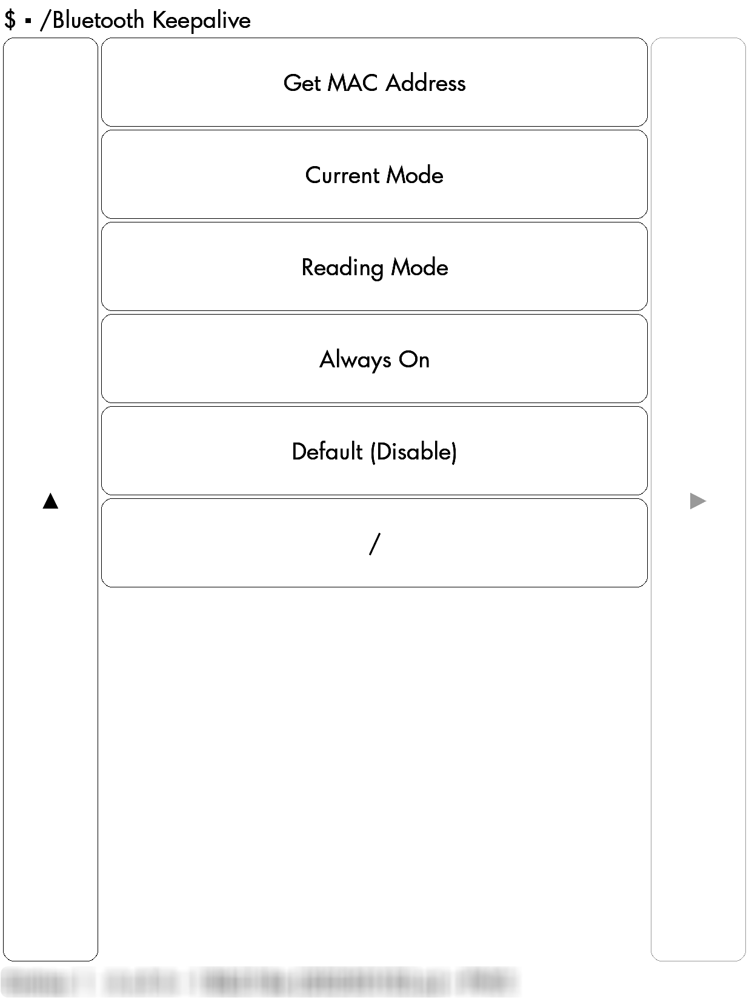
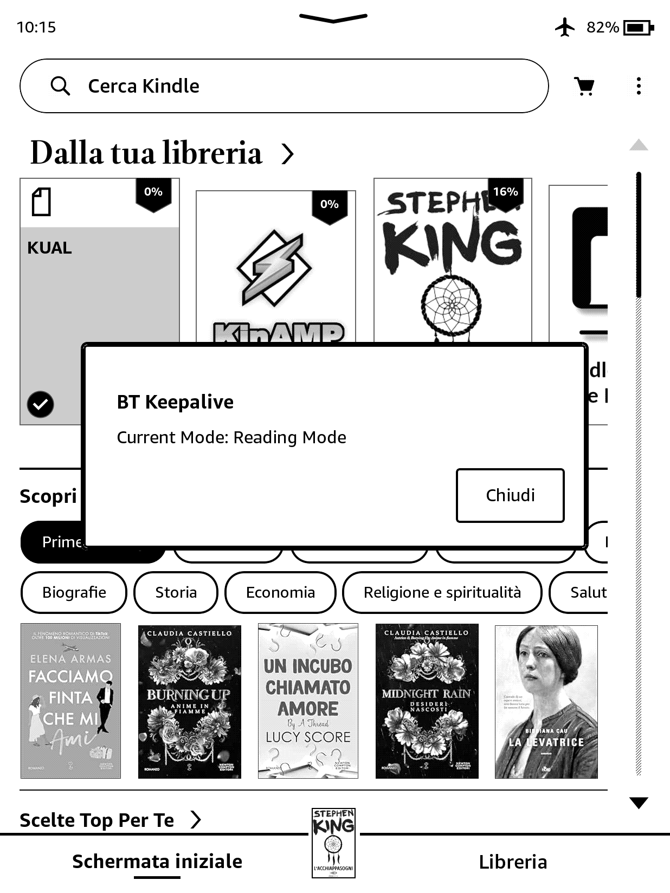
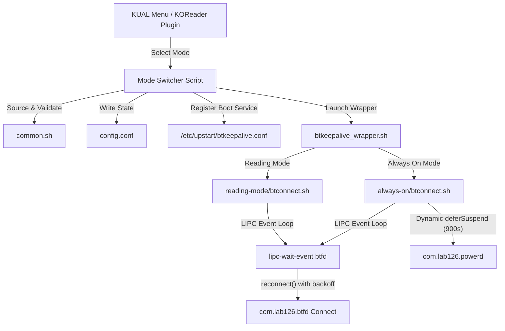

<p align="center" style="padding-top: 10px;">
  <picture>
    <source media="(prefers-color-scheme: dark)" srcset="assets/logo/kindle-bt-keepalive-logo-dark.png">
    
  </picture>
</p>

<h1 align="center">kindle-bt-keepalive</h1>

<p align="center">
  <strong>Persistent Bluetooth connection for jailbroken Kindle devices.</strong><br>
  <em>Maintains active connectivity for headphones, page-turners, and accessories without sleep disruptions.</em>
</p>

<p align="center">
  <a href="https://github.com/imanubdesigner/kindle-bt-keepalive/releases"></a>
  
  
  <a href="LICENSE"></a>
</p>

<p align="center">
  
  
  
</p>

<p align="center">
  <a href="#quick-start">Quick Start</a> •
  <a href="#features">Features</a> •
  <a href="#operating-modes">Operating Modes</a> •
  <a href="#installation">Installation</a> •
  <a href="#configuration">Configuration</a> •
  <a href="#how-it-works">How It Works</a> •
  <a href="#verification-and-diagnostics">Verification</a> •
  <a href="#frequently-asked-questions">FAQ</a>
</p>

---

## Overview & Motivation

For many readers, reading is an immersive ritual often paired with ambient audio—the sound of rainfall, natural soundscapes, or background music.

Amazon Kindle devices enforce aggressive power-saving policies that routinely sever Bluetooth connections during periods of inactivity or screen suspend. This results in unexpected disconnections of wireless headphones, Bluetooth page-turner remotes, speakers, and external controllers.

**kindle-bt-keepalive** is an event-driven background service that eliminates these interruptions. While conceived to enable continuous audio reading, it functions universally for any Bluetooth device paired with a jailbroken Kindle.

> [!NOTE]
> Tested and verified on **Kindle Paperwhite 11th Generation (Firmware 5.18.5.0.1)**. Compatible with all jailbroken Kindle models supporting KUAL and Upstart.

---

## Features

- **Universal Bluetooth Device Support**: Reconnects headphones, speakers, Bluetooth page-turners, and remote clickers.
- **Dual Interface Integration**: Native point-and-click control through both the KUAL menu and KOReader's Tools menu.
- **One-Click Hardware Discovery**: Directly query paired device MAC addresses on the e-ink screen (`Get MAC Address`).
- **Real-Time Daemon Monitoring**: The `Current Mode` action reports both active configuration and live daemon execution state.
- **Dual Operating Modes**:
  - **Reading Mode**: Preserves low-power deep sleep and re-establishes connection immediately upon wakeup or disconnect.
  - **Always On**: Defers device suspension with a dynamic 15-minute lease renewed every 5 minutes for continuous audio playback.
  - **Default (Disable)**: Restores vanilla Kindle state cleanly with a single click.
- **Battery Safety Watchdog**: Automatically releases power deferrals and halts the daemon when battery drops below a configurable threshold (default 20%).
- **Hardened Process Lifecycle**: Signal traps on `EXIT`, `INT`, and `TERM` prevent orphaned processes; Upstart configuration uses `normal exit 0` to prevent respawn loops.
- **Zero-Fork LIPC Matching**: Uses native shell pattern matching on D-Bus/LIPC events to minimize CPU wakeups and preserve battery.
- **Automated Log Rotation**: Built-in 256 KB size check prevents log overflow on internal storage.

---

## Screenshots

<p align="center">
  
  &nbsp;&nbsp;&nbsp;&nbsp;
  
</p>

---

## Operating Modes

| Mode | Purpose | Sleep Behavior | Battery Impact | Reconnection |
| :--- | :--- | :--- | :--- | :--- |
| **Reading Mode** *(Recommended)* | Reading with BT headphones or remotes | Normal deep sleep allowed | Minimal | Immediate upon wake & disconnect |
| **Always On** | Continuous playback (e.g., KinAMP) | Suspend deferred (device awake) | Higher (guarded by threshold) | Immediate with retry backoff |
| **Default (Disable)** | Vanilla Kindle state | Standard system default | None (daemon stopped) | Inactive |

> [!NOTE]
> **Understanding Reading Mode vs. Always On**:
> In **Reading Mode**, the Kindle is allowed to enter deep sleep to preserve battery. When the device sleeps, the hardware Bluetooth radio may suspend; as soon as the Kindle wakes or an event is triggered, the connection is re-established automatically. If you require zero audio interruption during screen suspend, use **Always On**.

---

## Quick Start

1. **Pair your device**: On your Kindle, navigate to **Settings → Bluetooth** and complete pairing.
2. **Deploy files**: Extract the release archive. Copy `btkeepalive/` and `extensions/` to the root of your Kindle USB drive (`/mnt/us/`).
3. **Retrieve MAC address**: Open **KUAL → Bluetooth Keepalive → Get MAC Address** to view your device's MAC.
4. **Configure**: Open `/mnt/us/btkeepalive/btkeepalive.conf` and replace `XX:XX:XX:XX:XX:XX` with your device's MAC.
5. **Activate**: Select **Reading Mode** or **Always On** from KUAL or KOReader.

---

## Installation

### Prerequisites
- Jailbroken Kindle with [KUAL](https://wiki.mobileread.com/wiki/KUAL) (Kindle Unified Application Launcher) installed.
- *(Optional)* [KOReader](https://github.com/koreader/koreader) for in-reader menu controls.
- *(Optional)* [KinAMP](https://github.com/kbarni/KinAMP) by [@kbarni](https://github.com/kbarni) for native local music playback on Kindle.

### 1. Download Release
Download the distribution archive: **[Download from GitHub Releases](https://github.com/imanubdesigner/kindle-bt-keepalive/releases)**.

### 2. Copy Folders to Kindle Drive
Connect your Kindle to your computer via USB:
1. Copy the `btkeepalive/` directory to `/mnt/us/` (Kindle USB drive root).
2. Copy the `extensions/` directory to `/mnt/us/` (Kindle USB drive root).
3. *(Optional for KOReader)*: Copy `btkeepalive.koplugin/` to `/mnt/us/koreader/plugins/`.

```
kindle-drive-root/ (/mnt/us/)
├── btkeepalive/              ← Core scripts, daemon, and common library
│   ├── always-on/
│   ├── bin/
│   │   ├── common.sh         ← Shared validation, logging, and helpers
│   │   └── btkeepalive_wrapper.sh
│   ├── reading-mode/
│   └── btkeepalive.conf      ← Configuration file
├── extensions/               ← KUAL menu integration
│   └── btkeepalive/
└── koreader/plugins/         ← Optional KOReader plugin
    └── btkeepalive.koplugin/
```

> [!TIP]
> **Windows users**: Drag and drop `btkeepalive` and `extensions` directly into the top-level folder of the Kindle drive in File Explorer.

---

## Configuration

Edit `/mnt/us/btkeepalive/btkeepalive.conf` with any standard text editor:

```bash
# MAC address of your Bluetooth device (headphones, page-turner, etc.)
# Find it using "Get MAC Address" in KUAL or KOReader
MAC="XX:XX:XX:XX:XX:XX"

# Minimum battery percentage before Always On mode releases sleep deferral
THRESHOLD=20

# Log file path (auto-created and auto-rotated at 256 KB)
LOGFILE="/mnt/us/btkeepalive/log/btkeepalive.log"
```

---

## How It Works



1. **Trigger & Validation**: Selecting a mode via KUAL or KOReader executes `set_reading.sh` or `set_always_on.sh`, which sources `common.sh`, validates the MAC address, and writes the selection to `config.conf`.
2. **Service Registration**: The script registers an Upstart service (`/etc/upstart/btkeepalive.conf`) configured with `normal exit 0` to enable clean boot persistence and prevent respawn loops.
3. **Execution & Event Loop**: `btkeepalive_wrapper.sh` initializes the appropriate daemon. The daemon monitors D-Bus/LIPC events (`com.lab126.btfd Disconnect_Result`) using native shell pattern matching and triggers a progressive retry backoff upon disconnection.
4. **Power Management**:
   - In **Reading Mode**, the device enters deep sleep normally; connection is restored immediately upon wake.
   - In **Always On**, `deferSuspend 900` is dynamically renewed every 5 minutes and automatically released if battery drops below the configured threshold.
5. **Clean Restoration**: Selecting **Default (Disable)** halts all processes, releases power deferrals, removes the Upstart job, and restores default Kindle behavior.

---

## Verification and Diagnostics

<details>
<summary><strong>Click to expand SSH / Terminal verification commands</strong></summary>

If you have terminal access via [kindle-usbnetlite](https://github.com/notmarek/kindle-usbnetlite) or KTerm:

```bash
# Check Upstart service status
initctl status btkeepalive

# View runtime wrapper logs
tail -f /mnt/us/btkeepalive/log/wrapper.log

# View Bluetooth connection activity
tail -f /mnt/us/btkeepalive/log/btkeepalive.log

# Inspect paired Bluetooth devices manually
cat /var/local/zbluetooth/bt_config.conf
```
</details>

---

## Frequently Asked Questions

**Can I use this with Bluetooth page-turners or remotes?**  
Yes. While developed with headphones and audio in mind, the keepalive loop reconnects any Bluetooth device configured in `btkeepalive.conf`.

**Where do I find my device MAC address?**  
Open KUAL or KOReader and select **Bluetooth Keepalive → Get MAC Address**. A screen notification displays the MAC addresses and sanitized names of paired devices.

**What happens when the Kindle reboots?**  
The Upstart service starts automatically upon boot and restores your last selected mode.

**How do I completely disable or uninstall the service?**  
Select **Default (Disable)** from KUAL or KOReader. This immediately terminates the daemon, uninstalls the Upstart job, and releases all power locks. You can then safely remove the `btkeepalive` folder.

**Does Reading Mode drain the battery?**  
No. Reading Mode allows your Kindle to enter deep sleep normally; it only reconnects when a disconnect event or device wakeup occurs.

---

## Acknowledgements

- [@notmarek](https://github.com/notmarek) — for [kindle-usbnetlite](https://github.com/notmarek/kindle-usbnetlite).
- [@kbarni](https://github.com/kbarni) — for [KinAMP](https://github.com/kbarni/KinAMP), the native e-ink music player for Kindle.
- [KUAL Team](https://wiki.mobileread.com/wiki/KUAL) — for the Kindle Unified Application Launcher.
- [KOReader Team](https://github.com/koreader/koreader) — for the extensible document reader and plugin architecture.

---

## Disclaimer

**This project is the result of independent study and personal experimentation.**  
The author disclaims all responsibility for potential hardware or software damage, data loss, or voiding of device warranties that may arise from using this software. This project is provided "as is", without warranty of any kind.

---

## License

This project is licensed under the [MIT License](LICENSE) - see the LICENSE file for details.

---

<p align="center">
  kindle-bt-keepalive • Licensed under the MIT License
</p>
